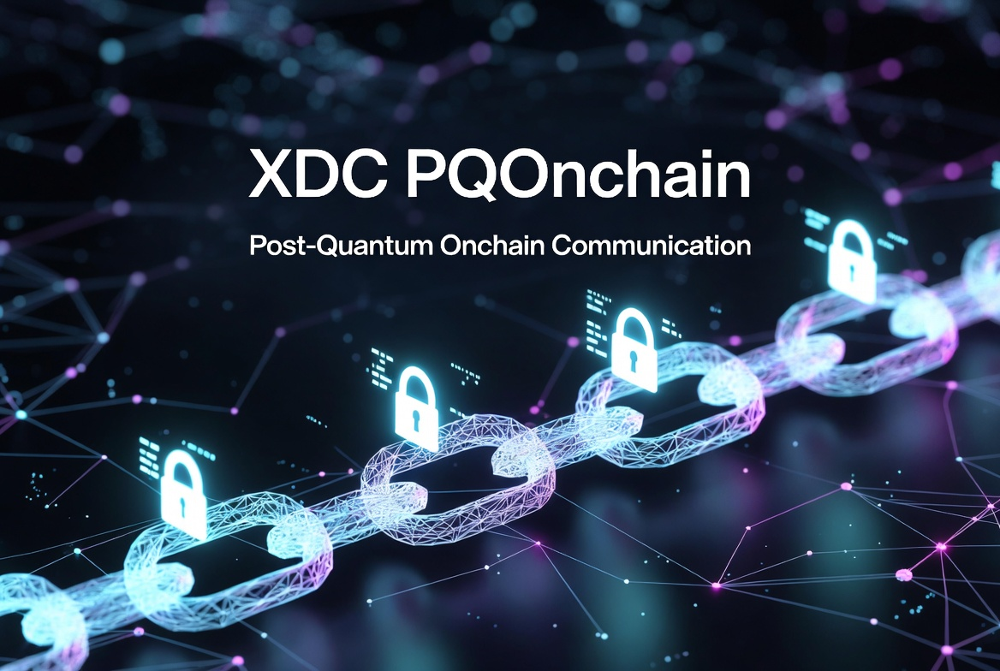

# XDC PQOnchain: post-quantum encrypted messages on XDC

Send messages on the XDC Network that only the recipient can read, encrypted with **ML-KEM-768** (the post-quantum key-encapsulation standard NIST published as FIPS 203) and **AES-256-GCM**. Everything runs in your browser: keys and messages never touch a server.

**[Open PQOnchain →](https://xdcoutpost.xyz/XDC_PQOnchain/?utm_source=github)**

Part of [XDC Outpost](https://xdcoutpost.xyz/?utm_source=github-pqonchain) · ⭐ Star the repo if it helps you.

## Why post-quantum?

Data written to a public blockchain stays there forever. "Harvest now, decrypt later" attacks collect encrypted data today, to break once quantum computers mature. ML-KEM is designed to resist them.

## How to use it

### 1. Create your keys (to receive messages)
- Click **Generate keypair**. The keys are created in your browser.
- **Share your public key** with anyone who wants to message you.
- **Save your private key** offline: click **Download both keys**, or copy it. It's hidden until you click **Show**. Anyone with it can read your messages, and if you lose it they can't be recovered.

You don't need keys of your own just to send.

### 2. Send a message
- **Connect MetaMask.** The page switches it to the XDC Network, adding the network if needed.
- Enter the **recipient address** (xdc… or 0x…) and paste their **public key**.
- Write your message. Optionally, send some XDC with it.
- Click **Encrypt and send** and confirm in MetaMask.
- When it's confirmed, **copy the transaction hash and send it to the recipient**. They need it to read the message. There's also a link to view it on XDCScan.

MetaMask won't send data transactions between two addresses in the same wallet, so the recipient must be in a different wallet. To test it yourself, use two wallets or two browser profiles.

### 3. Read a message
- Paste the **transaction hash** and **your private key**.
- Click **Decrypt message**. No wallet connection is needed.

## What goes on chain

Each message is stored in the data field of an ordinary XDC transaction, in this order:

| Part | Size | What it is |
|---|---|---|
| ML-KEM-768 ciphertext | 1,088 bytes | The encapsulated key, which only the recipient's private key can open |
| IV | 12 bytes | Random value for AES-GCM |
| Encrypted message | your message + 16 bytes | Your text, encrypted with AES-256-GCM |

**Only the message is private.** The sender, recipient, amount and time are public, like any XDC transaction.

## How it's built

Plain HTML and JavaScript with:
- [mlkem](https://github.com/dajiaji/crystals-kyber-js) 2.7.0 for ML-KEM-768
- [ethers.js](https://github.com/ethers-io/ethers.js) 5.7.2 for the wallet and RPC
- the browser's built-in Web Crypto API for AES-GCM

Both libraries are **stored in this repo, at fixed versions** (`vendor/`), rather than loaded from a CDN. The code that handles your keys can't change without a visible commit here.

## Contact

Questions, bugs or ideas: open a [GitHub issue](https://github.com/s4njk4n/XDC_PQOnchain/issues), or message me on [Telegram](https://t.me/s4njk4n) or [X](https://x.com/s4njk4n).

[MIT License](LICENSE). Provided as-is, without warranty. Experimental software: don't use it for anything where a lost key or a bug would be costly.
